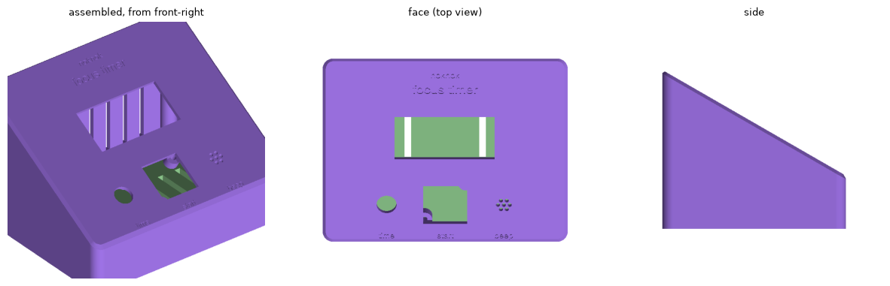
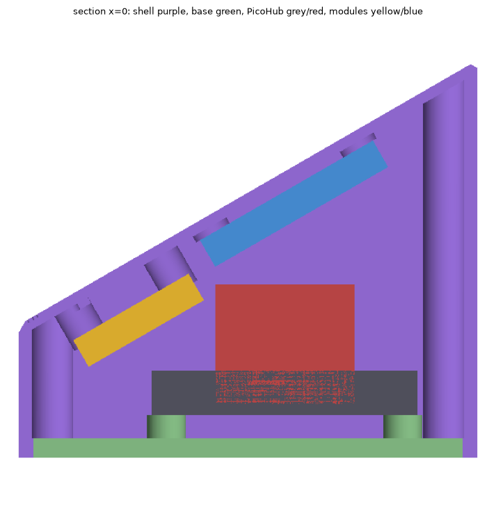

<!--
SPDX-FileCopyrightText: 2026 noknok (Christopher Houben)
SPDX-License-Identifier: CC-BY-SA-4.0
-->

# Focus Timer housing

Desk wedge, 92 x 69 mm footprint, 20 mm high at the front, 60 mm at the back, face tilted 30 degrees towards the user.
Product: [`focus-timer-v1`](https://github.com/buildwithnoknok/poc/pull/3) (Pomodoro timer).

## Parts (all in `out/`, STL in print pose, STEP for CAD)

| File | Print | Notes |
| --- | --- | --- |
| `focus-timer_shell.stl` | 1x, face down | walls, slanted face, engraved labels (`time`, `start`, `beep`, `focus timer`, `noknok`), USB-C power slot and vents in the back wall, 4 base-screw bosses |
| `focus-timer_base.stl` | 1x, flat | 4 PicoHub standoffs, 4 countersunk screw holes, vents under the hub, 4 feet recesses |
| `focus-timer_knob_cap.stl` | 1x, upright | d13 x 18.4 grip cap, 12 flutes, pointer groove. Inside from the bottom: d7.6 counterbore over the bushing, d6.2 round bore, D-shaped bore (6.2 x 4.7 across the flat) over the flat of the EC11E shaft, closed roof. Sits 0.6 mm above the face. d25 was print-tested (fits the Knob perfectly, too big), d13 is the slimmer version: 7 mm from the LED Button key |

## Face layout (looking at the face)

Front row, left to right: Knob, LED Button, Buzzer (22 mm pitch). Display above them, centred. Layout is the list `LAYOUT`
in `build.py` (module, x from the face centre, y up the slope).

## Assembly

1. Print the fit coupon first (`../quiz-buzzers/out/noknok_fit_coupon.stl`); pick the shaft hole, pilot and key opening sizes that fit your parts.
2. Put each module face-down into the shell: its top side (switch, encoder, buzzer, display glass) goes through / against the plate. Screw it from
   behind (Knob, LED Button, Buzzer: M2.5 x 6; Display: M2.5 x 4).
3. Plug the Pico 2 W into the PicoHub, screw the hub to the base standoffs (4x M2.5 x 6). Turn it so the USB-C **power** connector faces the
   back wall (the hub's Qwiic ports J3/J4 then face the front).
4. Cable chain with 100 mm Qwiic cables: hub J3 > Knob > LED Button > Buzzer > Display (daisy chain, order does not matter).
5. Feed the power cable through the back slot, lay the base into the shell, 4x M2.5 x 6 from below. Press the knob cap on. Stick the feet on.

## Numbers you may want to change (top of `build.py` / `lib/wedge.py`)

`TH` wedge angle (30), `D` depth (69, set by the PicoHub height), `HF` front height (20), `WALL` (1.6), `TF` face thickness (2.0),
`BP` base thickness (3.0), `BORE` (6.2) and the `ENC` datasheet numbers in `build.py`, `M25_PILOT` (2.4) in `lib/nk_cad.py`.
