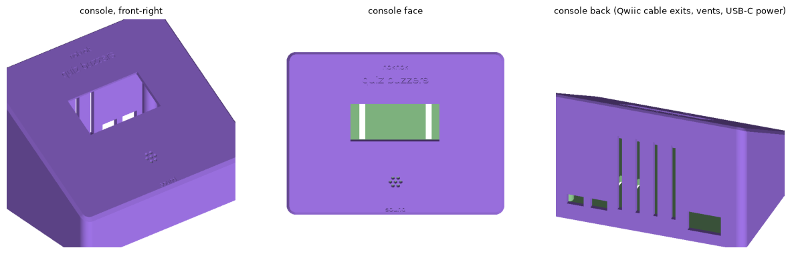
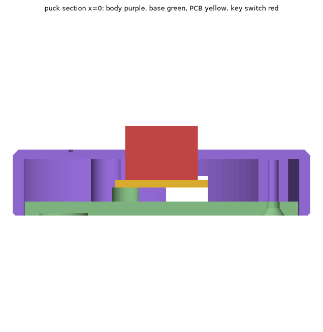

<!--
SPDX-FileCopyrightText: 2026 noknok (Christopher Houben)
SPDX-License-Identifier: CC-BY-SA-4.0
-->

# Quiz Buzzers housing

One console and four team pucks. Product: [`quiz-buzzers-v1`](https://github.com/buildwithnoknok/poc/pull/1).
The pucks are daisy-chained with Qwiic cables: console > puck 1 > puck 2 > puck 3 > puck 4.

## Parts (`out/`)

| File | Print | Notes |
| --- | --- | --- |
| `quiz-buzzers_console_shell.stl` | 1x, face down | the Focus Timer wedge with a Display and a Buzzer on the face; two Qwiic cable exits (hub ports J5/J6), USB-C power slot, vents |
| `quiz-buzzers_console_base.stl` | 1x, flat | identical to the Focus Timer base |
| `quiz-buzzers_puck_body_1..4.stl` | 4x, in four colours | d64 x 14 mm tube + deck (deck down on the bed), key opening 16.4 x 16.2, team number engraved, two cable windows (W and E) |
| `quiz-buzzers_puck_base.stl` | 4x, flat | 2 PCB standoffs, 3 countersunk screws, 3 feet recesses |
| `noknok_fit_coupon.stl` | 1x | shaft holes, M2.5 pilots, key openings: print first |

Puck stack (mm): base 3.0, standoffs 3.0 (bottom-side parts and the JST sockets live here), PCB 1.6, deck inner face 4.5 above the PCB
(`clearance_top` of the LED Button), deck 2.0. The switch body pokes through the deck.

## Assembly (puck)

1. Screw the LED Button to the base standoffs (2x M2.5 x 6), key side up.
2. Slide the body over it (the key goes through the opening, the cable windows line up with the JST sockets).
3. 3x M2.5 x 6 from below. Feet. Plug the cable to the previous puck / the console.

Console: as the Focus Timer, without Knob and LED Button; the Qwiic cable to puck 1 leaves through one of the two back-wall windows.
